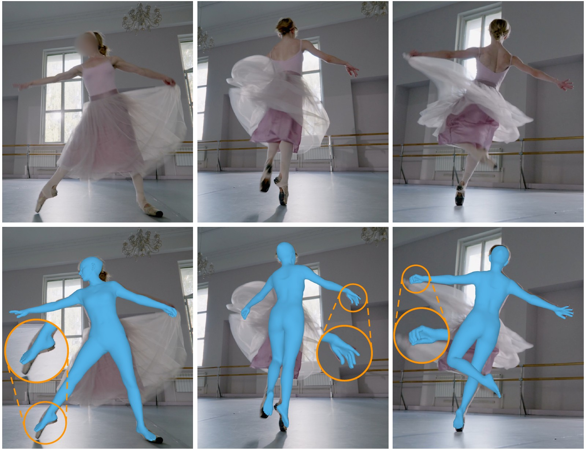
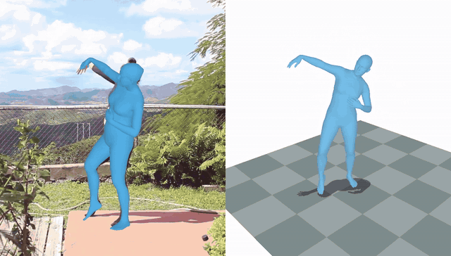

# ExMR: Extremity Motion Refinement for Monocular Human Motion Capture

[](https://arxiv.org/abs/2610.26213)
[](https://twehrbein.github.io/exmr-website/)
[](https://huggingface.co/twehrbein/ExMR)



> **ExMR: Extremity Motion Refinement for Monocular Human Motion Capture** <br>
> [Tom Wehrbein](https://www.tnt.uni-hannover.de/en/staff/wehrbein/) and [Bodo Rosenhahn](https://www.tnt.uni-hannover.de/en/staff/rosenhahn/) <br>
> arXiv 2026 (journal extension of [FootMR](https://twehrbein.github.io/footmr-website/), 3DV 2026)

> [!NOTE]
> This repository currently contains the demo code. Evaluation and training code will follow.

## News

- **[2026-10-22]** [v0.1.3](https://github.com/twehrbein/ExMR/releases/tag/v0.1.3): export for
  Blender (AMASS SMPL-X file), `--snap_to_ground` and temporal smoothing.
- **[2026-10-21]** Demo code and model weights released.
- **[2026-10-20]** Paper on [arXiv](https://arxiv.org/abs/2610.26213).

## Overview

Detailed hand and foot articulation is important for animation and motion analysis, yet remains
challenging to recover from monocular video. ExMR (Extremity Motion Refinement) reconstructs 3D body,
hand, and foot motion from monocular video: an initial temporal estimator predicts whole-body motion,
after which a foot refinement module (FootMR) and a hand refinement module (HandMR) revisit local
evidence to predict residual joint rotations for the extremities.

## Setup

Tested on Linux with an NVIDIA GPU (about 8 GB of GPU memory, driver >= 570 for CUDA 12.8).
Request access to [SAM 3D Body](https://huggingface.co/facebook/sam-3d-body-dinov3) on Hugging Face
first: its weights are gated and access is approved manually, which can take a while. Please see
[installation](docs/INSTALL.md) for details.

## Quick Start

Reconstruct the main person in a video:

```bash
python tools/demo.py --video path/to/video.mp4      # moving camera
python tools/demo.py --video path/to/video.mp4 -s   # static camera (better world trajectory)
```

For example, download the [dancing video](https://www.pexels.com/video/woman-doing-dancing-exercise-in-the-garden-3690649/)
from Pexels (1906x1080, filmed with a static camera) and run

```bash
python tools/demo.py --video 3690649-hd_1906_1080_30fps.mp4 -s
```



Results go to `outputs/<video name>/`: SMPL-X parameters in the camera and in a gravity-aligned
world frame (`results.pt`, `results.npz`), the world-frame motion as an AMASS file that the SMPL-X
Blender add-on imports (`<video name>_amass.npz`, see [Blender](docs/OUTPUTS.md#blender-and-amass))
and rendered videos, see [outputs](docs/OUTPUTS.md).

`--mode` trades speed for accuracy. Times are for the 37-second example video (1122 frames, `-s`)
on an RTX 4090, including model loading and rendering:

| `--mode` | Person detector | 2D keypoints | Camera motion (moving camera) | Time |
|---|---|---|---|---:|
| `fast` | YOLO11m | RTMW-x | SimpleVO | 1&nbsp;min&nbsp;9&nbsp;s |
| `balanced` (default) | YOLO11m | Sapiens2-1B 448x336 | SimpleVO | 1&nbsp;min&nbsp;23&nbsp;s |
| `accurate` | YOLO11x | Sapiens2-1B 1024x768 | DPVO | 3&nbsp;min&nbsp;22&nbsp;s |

In our evaluation, Sapiens2-1B gives nearly the same accuracy at 448x336 and 1024x768; RTMW-x is
slightly less accurate, mostly for the feet. With `-s` (static camera), no mode estimates camera
motion; otherwise `accurate` uses DPVO, which needs the optional DPVO install (see
[camera motion](#camera-motion)).

Other options:

* `--detector`, `--pose_backend`, `--sapiens2_resolution`, `--vo`: override single parts of the
  mode, e.g. `--mode accurate --vo simplevo` without DPVO.
* `--fps30`: resample the video to 30 fps first. Usually not needed; ExMR is trained on 30 fps
  videos, so you may try it for videos far from 30 fps (e.g. 50 fps or more). For such videos it
  also makes the demo faster, since fewer frames are processed. The results then follow the
  frames of the resampled video.
* `--snap_to_ground`: in long videos, the world-frame motion can drift vertically (the person
  seems to fly or sink). If the scene has a single flat ground and nothing to stand on (no
  stairs, chairs, ...), the body touches the ground at least every 0.5 s, about the hang time of
  a jump; this option moves the world-frame motion vertically so that it does, as in
  [PRIMAL](https://arxiv.org/abs/2503.17544). Jumps with a longer flight are pulled down.
* `--smoothing {global,both,none}`: temporal smoothing of the output motion (Gaussian, ~33 ms).
  By default (`global`) only the world-frame motion is smoothed; the camera-frame motion stays
  raw, best aligned with the image. `both` also smooths the camera-frame motion (smoother, but
  fast foot motion is followed slightly less closely in the image); `none` keeps the raw output.
* `--no_render`: only save the results.

Intermediate results are cached in `outputs/<video name>/cache/`, so rerunning the demo (e.g.
with `--no_render` removed, or another option) only recomputes what changed.

### Camera motion

ExMR uses the camera's rotation over time to place the motion in the world frame. If the camera
does not move, pass `-s`: this gives the best world trajectory. Otherwise the rotation is estimated
from the video:

* **SimpleVO** (default): a simple classical method from GVHMR (SIFT feature matches between every
  8th frame and two-view geometry, on the CPU). It needs no extra installation and runs while the
  GPU stages run, so it adds no time.
* **DPVO** (`--vo dpvo`, used by `--mode accurate`):
  [Deep Patch Visual Odometry](https://github.com/princeton-vl/DPVO), a learned and widely used
  method that tracks every frame on the GPU. It needs an optional source build
  ([installation](docs/INSTALL.md)), adds about 1-2.5 s per 100 frames on an RTX 4090 (1080p to
  4K), and repeated runs differ slightly.

If the world-frame motion looks wrong with SimpleVO, try DPVO.

### Python

The demo is a thin wrapper around `run_video`, which you can also call from your own code:

```python
from exmr.pipeline import Options, run_video

results = run_video("video.mp4", "outputs/video", Options(static_cam=True, render=False))
body_pose = results["smplx_global"]["body_pose"]  # (L, 63), see docs/OUTPUTS.md
```

`Options` has the same settings as the demo's command-line options (default: `balanced` mode). The
model files are read from `checkpoints/` (or `$EXMR_CHECKPOINT_DIR`).

## How it works

`run_video` (`exmr/pipeline.py`) runs these steps and caches the result of each one:

| Step | Code |
|---|---|
| Frame extraction | `exmr/preprocessing/video.py` |
| Person detection and tracking (YOLO11 + ByteTrack) | `exmr/preprocessing/tracker.py` |
| 2D keypoints (Sapiens2 or RTMW) | `exmr/preprocessing/keypoints/` |
| Body image features (SAM 3D Body) | `exmr/preprocessing/body_features.py` |
| Hand image features (HaMeR) | `exmr/preprocessing/hand_features.py` |
| Camera rotations (SimpleVO or DPVO) | `exmr/preprocessing/visual_odometry.py` |
| ExMR: initial whole-body estimate, then FootMR and HandMR | `exmr/model/exmr.py`, with `body_net.py` and `refiners.py` |
| World-frame trajectory and post-processing (static joints, camera drift, ground contact, IK) | `exmr/model/global_traj.py` |
| Temporal smoothing | `exmr/model/exmr.py`, `exmr/geometry/smoothing.py` |
| Export for Blender (AMASS SMPL-X file) | `exmr/export.py` |
| Rendered videos | `exmr/vis/` |

## Citation

If you find this work useful, please cite our papers and the original [GVHMR](https://github.com/zju3dv/GVHMR) work:

```bibtex
@Article{wehrbein26exmr,
    author    = {Wehrbein, Tom and Rosenhahn, Bodo},
    title     = {{ExMR}: Extremity Motion Refinement for Monocular Human Motion Capture},
    journal   = {arXiv preprint arXiv:2610.26213},
    year      = {2026},
}
```

```bibtex
@InProceedings{wehrbein26footmr,
    author    = {Wehrbein, Tom and Rosenhahn, Bodo},
    title     = {Improving 3D Foot Motion Reconstruction in Markerless Monocular Human Motion Capture},
    booktitle = {International Conference on 3D Vision (3DV)},
    year      = {2026},
    pages     = {871--881},
    doi       = {10.1109/3DV69130.2026.00088},
}
```

```bibtex
@InProceedings{shen2024gvhmr,
    author    = {Shen, Zehong and Pi, Huaijin and Xia, Yan and Cen, Zhi and Peng, Sida and Hu, Zechen and Bao, Hujun and Hu, Ruizhen and Zhou, Xiaowei},
    title     = {World-Grounded Human Motion Recovery via Gravity-View Coordinates},
    booktitle = {SIGGRAPH Asia Conference Proceedings},
    year      = {2024},
}
```

## License

This code is a derivative work of [GVHMR](https://github.com/zju3dv/GVHMR) and is released for
educational, research and non-profit purposes only, see [LICENSE](LICENSE). It builds on third-party
models and code under their own licenses, see [THIRD_PARTY_NOTICES.md](THIRD_PARTY_NOTICES.md).
Person detection and tracking use [Ultralytics YOLO](https://github.com/ultralytics/ultralytics)
(AGPL-3.0).
ExMR uses [SAM 3D Body](https://github.com/facebookresearch/sam-3d-body) under the SAM License,
which requires publications of results obtained with it to acknowledge the use of SAM materials.
