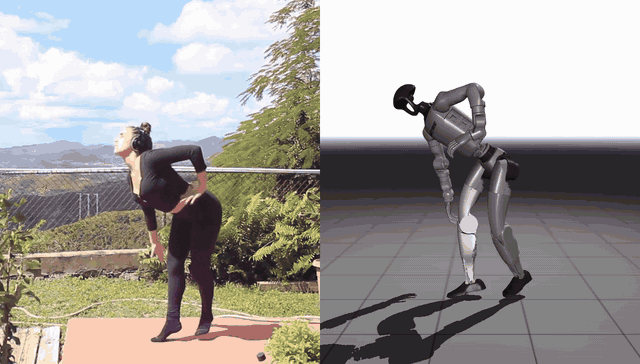

# Demo outputs

`python tools/demo.py --video <video>` writes to `--output_dir` (default `outputs/<video name>`):

| File | Content |
|---|---|
| `results.pt` | reconstruction: SMPL-X parameters and 3D/2D joints (PyTorch, see below) |
| `results.npz` | the same as NumPy arrays, with flattened keys (`smplx_incam_body_pose`, ...) |
| `<name>_amass.npz` | the world-frame motion as an AMASS SMPL-X file, e.g. for [Blender](#blender-and-amass) or [humanoid robots](#humanoid-robots-gmr) |
| `<name>_incam.mp4` | SMPL-X mesh rendered over the input video |
| `<name>_global.mp4` | SMPL-X mesh in the world frame, with a ground plane, seen by a static camera |
| `<name>_incam_global.mp4` | both side by side (scaled down to at most 4096 pixels wide) |
| `cache/` | cached preprocessing results (reused when the demo is run again with the same settings) |
| `run.json` | the video and options of the run (e.g. `smoothing`) |

## results.pt

```python
results = torch.load("results.pt")
```

For a video with `L` frames:

| Key | Shape | Description |
|---|---|---|
| `smplx_incam` | dict | SMPL-X parameters in the camera frame (x right, y down, z forward); not smoothed over time unless `--smoothing both` |
| `smplx_global` | dict | SMPL-X parameters in a gravity-aligned world frame (y up); the motion starts at the origin (x, z) and stands on the ground y=0: the lowest mesh vertex over all frames is at y=0 (with `--snap_to_ground`: the lowest vertex within every 0.5 s); smoothed over time unless `--smoothing none` |
| `joints_incam`, `joints_global` | <code>(L,&nbsp;76,&nbsp;3)</code> | 3D joints of `smplx_incam` and `smplx_global` in meters, see [joints](#joints) |
| `joints_2d` | <code>(L,&nbsp;76,&nbsp;2)</code> | `joints_incam` projected into the image with `K_fullimg`, in pixels |
| `joint_names` | 76 | names of the joints, e.g. `left_heel` |
| `static_conf_logits` | `(L, 6)` | logits of [left ankle, left foot, right ankle, right foot, left wrist, right wrist] being static (in contact) |
| `K_fullimg` | <code>(L,&nbsp;3,&nbsp;3)</code> | camera intrinsics used (estimated from the image size) |
| `bbx_xyxy` | `(L, 4)` | tracked bounding box of the person, `[x1, y1, x2, y2]` in pixels |
| `fps` | float | frame rate of the processed video |

Both SMPL-X parameter dicts contain, per frame, axis-angle rotations:

| Key | Shape | Description |
|---|---|---|
| `global_orient` | `(L, 3)` | root rotation |
| `body_pose` | `(L, 63)` | 21 body joints, relative to their parent |
| `left_hand_pose`, `right_hand_pose` | `(L, 45)` | 15 finger joints per hand (full axis-angle, no PCA, flat hand mean) |
| `betas` | `(L, 10)` | body shape (the same for all frames) |
| `transl` | `(L, 3)` | root translation in meters |

Face parameters (jaw, eyes, expression) are not estimated; use zeros.

To get the mesh with the [smplx](https://github.com/vchoutas/smplx) package:

```python
import smplx

params = results["smplx_incam"]  # or results["smplx_global"]
L = len(params["body_pose"])
model = smplx.SMPLX(
    "SMPLX_NEUTRAL.npz", use_pca=False, flat_hand_mean=True, num_betas=10, batch_size=L
)  # batch_size: the face parameters, which ExMR does not estimate, default to zeros of that size
output = model(**params)
vertices = output.vertices  # (L, 10475, 3)
joints = output.joints[:, :76]  # (L, 76, 3): joints_incam or joints_global of results.pt
```

`exmr.body_models.smplx_model.SmplxModel` gives the same vertices and joints.

### Joints

The 76 joints are the 55 joints of the SMPL-X skeleton followed by 21 points on the mesh surface,
in the order of the [smplx](https://github.com/vchoutas/smplx) package's output (`joint_names`):

| Index | Joints |
|---|---|
| 0-21 | pelvis and 21 body joints (the same as SMPL's first 22, e.g. for comparisons with SMPL-based methods) |
| 22-24 | jaw, left and right eye (the face is not estimated: they follow the head) |
| 25-54 | 15 finger joints per hand, left hand first |
| 55-59 | nose, right and left eye, right and left ear (surface points) |
| 60-65 | big toe, small toe and heel, left foot first (surface points) |
| 66-75 | fingertips, thumb to pinky, left hand first (surface points) |

The skeleton joints are rotation centers inside the body, the surface points lie on the skin, like
the foot and fingertip keypoints of 2D detectors such as OpenPose.

`exmr.pipeline.compute_joints` computes the joint keys (`joints_incam`, `joints_global`,
`joints_2d`, `joint_names`) from the SMPL-X parameters, e.g. for results of ExMR versions before
0.1.4, which have none:

```python
from exmr.pipeline import compute_joints

results |= compute_joints(results, "SMPLX_NEUTRAL.npz")
```

## Blender and AMASS

`<name>_amass.npz` holds the world-frame motion (`smplx_global`) in the layout of the SMPL-X files
of [AMASS](https://amass.is.tue.mpg.de), which the SMPL-X Blender add-on imports:

1. Download "SMPL-X for Blender" from the [SMPL-X website](https://smpl-x.is.tue.mpg.de)
   (registration, Blender 4.5 or newer) and install the zip in Blender (Edit > Preferences > Get
   Extensions > Install from Disk).
2. In the 3D viewport's sidebar (View > Sidebar), tab "SMPL Models", click "Add Animation" and
   select the file. The default settings fit (Format: AMASS, Hand pose reference: Flat).
3. Set "Target framerate" to the file's frame rate (`mocap_frame_rate`) or a divisor of it, e.g. 25
   for a 25 fps video: the add-on rejects targets above the frame rate and otherwise keeps every
   (frame rate / target)-th frame, rounded down. Its default of 30 suits 30 and 60 fps videos.
4. For the exact SMPL-X mesh, enable "Use keyframed corrective pose weights" (slower import and
   playback). Without it, the skeleton moves the same, but the mesh lacks SMPL-X's pose-dependent
   shape corrections.

The add-on's default body model is SMPL-X "locked head" (without the head bun of SMPL-X v1.1,
which ExMR uses). The joints and the body agree within about a millimeter; only the head differs.

As in AMASS, the world frame is z-up with the ground at z=0: the motion is `smplx_global` rotated
by 90 degrees about the x-axis, i.e. the point (x, y, z) of `smplx_global` is at (x, -z, y). The
hand poses are relative to the flat hand, as in `results.pt`.

| Key | Shape | Description |
|---|---|---|
| `poses` | `(L, 165)` | axis-angle rotations of the 55 SMPL-X joints: root, 21 body joints, jaw, 2 eyes, 15 + 15 finger joints (jaw and eyes are zero) |
| `root_orient`, `pose_body`, `pose_jaw`, `pose_eye`, `pose_hand` | `(L, 3)`, `(L, 63)`, `(L, 3)`, `(L, 6)`, `(L, 90)` | the same, split into parts |
| `trans` | `(L, 3)` | root translation in meters |
| `betas` | `(16,)` | body shape: ExMR's 10 betas, padded with zeros to the 16 of AMASS (`num_betas`: 16) |
| `gender`, `surface_model_type` | | `neutral`, `smplx` |
| `mocap_frame_rate` | | frame rate, rounded to an integer (the Blender add-on reads it as one); the exact rate is `fps` in `results.pt` |

`exmr.export.save_amass` writes the file from `results.pt`, e.g. for results of an earlier ExMR
version:

```python
from exmr.export import save_amass

save_amass(results["smplx_global"], results["fps"], "motion_amass.npz", "SMPLX_NEUTRAL.npz")
```

## Humanoid robots (GMR)

[GMR](https://github.com/YanjieZe/GMR) (General Motion Retargeting) retargets AMASS SMPL-X files
to humanoid robots, e.g. the Unitree G1 and H1, Booster T1 or Fourier N1 (see its list).



Install GMR as described in its README, put ExMR's `checkpoints/body_models/smplx/SMPLX_NEUTRAL.npz`
into GMR's `assets/body_models/smplx/` and run, in the GMR repository:

```bash
python scripts/smplx_to_robot.py --smplx_file <name>_amass.npz --robot unitree_g1 \
    --save_path <name>_unitree_g1.pkl --rate_limit
```

- The robot keeps the height of the motion above the ground, so run ExMR with `--snap_to_ground`
  if the scene allows it (see the [README](../README.md)): otherwise vertical drift of the
  world-frame motion lets the robot float or sink.
- GMR treats motions below 30 fps as 30 fps motions without resampling them, so e.g. a 25 fps
  motion plays too fast. For videos below 30 fps, run ExMR with `--fps30`.
- GMR retargets the body only and ignores the finger motion, also for robots with hands.
- Sudden robot arm motions that the SMPL-X mesh does not show come from the retargeting: GMR
  solves every frame on its own and can switch the robot's arm between joint configurations that
  reach the same pose. The same happens with ground-truth motion.
